# migration-pip.md — グローバル pip 134 件の mise + uv 移行計画

> 対象: `C:\Users\%USERNAME%\AppData\Local\Programs\Python\Python313`（base）＋ `%APPDATA%\Python\Python313`（pip --user）の**グローバル pip 134 件**。
> 移行先: **mise（pypi backend = uv）** ＋ **`uv tool`** ＋ プロジェクトローカルの `uv`/`mise`。依存取得は **Takumi Guard**（`pypi.flatt.tech`）。
> 目標グローバル Python: **3.14.8**（`inventory.md` §3 / `PLAN.md` §3）。
> 本作業は **READ-ONLY**（一切インストール/削除/変更していない）。以下のコマンドはすべて「推奨手順」であり未実行。

---

## 0. 結論サマリ（TL;DR）

1. **この 134 件は「グローバルツール」ではない。ルートは 2 つだけ。**
   - **`whisperx 3.7.6`**（ASR + 話者分離スタックを丸ごと引き込む）→ base site-packages **93 件**
   - **`poetry 2.2.1`**（`pip install --user poetry` 由来）→ user site **41 件 = poetry の依存閉包そのもの**
   - 93 + 41 = **134** ✓（実測一致）
2. **コンソールスクリプトを持つのは 39 パッケージ / 58 ファイル**（base 44 ＋ user 14、実機の `Scripts\` を実測）。
3. **グローバルに残す価値があるのは 4〜8 件だけ**（`hf`, `optuna`, `nltk`, `tqdm` ＋ 任意で `httpx`/`pygments`/`tabulate`/`poetry`）。残りは **project-local**。
4. **Python 3.14 の確定ブロッカーは 1 つだけ: `whisperx`**（`Requires-Python: <3.14,>=3.10` — METADATA 実測）。
   他 133 件は**下限のみ**（上限なし）。→ 「グローバル 3.14 ＋ ASR 系プロジェクトだけ 3.13」で**矛盾なく解決できる**。
5. **`networkx 3.6.1` は `Requires-Python: !=3.14.1`** → **3.14.1 だけ**避ける（目標 3.14.8 は OK）。

---

## 1. 一次証拠（どうやって確定したか）

| 証拠源 | 実測値 |
|---|---|
| `inventory-pip.txt`（global 134） | 89 件が base、41 件が user site と重複 |
| `inventory-pip-user.txt`（--user 41） | poetry の依存閉包（後述 §3.3 で証明） |
| base: `...\Programs\Python\Python313\Lib\site-packages` | **93** dist-info（`*.dist-info/METADATA` を実読） |
| user: `%APPDATA%\Python\Python313\site-packages` | **41** dist-info |
| base: `...\Programs\Python\Python313\Scripts` | **44** エントリ（`Get-ChildItem` 実測） |
| user: `%APPDATA%\Python\Python313\Scripts` | **14** エントリ |
| `METADATA` の `Requires-Python` | 3.14 互換性の**一次証拠**（§8） |
| `METADATA` の `Requires-Dist` | 「誰が何を引き込んだか」の**一次証拠**（§3） |

> 注: `pip list`（グローバル）は **user site を含む**ため、`inventory-pip.txt` の 134 には `poetry` 等が混ざる。
> `inventory.md` §2 line 47 / §3.1 line 81 はこれを **「Python 3.10（別系統）」**と書いているが**誤り**。
> 正しくは **Python 3.13 の `pip --user` site**（`%APPDATA%\Python\Python313`）。→ 付録 B 参照。

---

## 2. 134 件のバケット分類

`CLI` 列 = コンソールスクリプトを持つパッケージ数（実測、§4）。

| # | バケット | 件数 | CLI | 代表 |
|---|---|---:|---:|---|
| A | ML/DL コア（torch・学習・推論） | 18 | 4 | `torch`, `torchaudio`, `pytorch-lightning`, `lightning`, `ctranslate2`, `onnxruntime`, `scikit-learn` |
| B | LLM / NLP / HF エコシステム | 8 | 3 | `transformers`, `huggingface_hub`, `tokenizers`, `safetensors`, `nltk`, `sentencepiece` |
| C | 音声 / ASR / 話者分離 | 10 | 6 | `whisperx`, `faster-whisper`, `pyannote.audio`, `pyannote.{core,database,metrics,pipeline}`, `soundfile`, `av`, `julius` |
| D | 科学計算 / データ / 可視化 | 17 | 3 | `numpy`, `scipy`, `pandas`, `matplotlib`, `fonttools`, `sympy`, `networkx`, `pillow` |
| E | 設定 / シリアライズ / 汎用 lib | 24 | 2 | `omegaconf`, `PyYAML`, `ruamel.yaml`, `protobuf`, `fsspec`, `filelock`, `Jinja2`, `Mako`, `markdown-it-py` |
| F | Web / HTTP / 非同期 | 18 | 3 | `aiohttp`, `httpx`, `requests`, `urllib3`, `anyio`, `certifi`, `CacheControl` |
| G | Python 環境 / パッケージング / ビルド | 24 | 10 | `poetry`, `virtualenv`, `build`, `pip`, `keyring`, `dulwich`, `pbs-installer`, `findpython`, `pkginfo`, `trove-classifiers` |
| H | CLI フレームワーク / 端末 UX / 小物 CLI | 10 | 5 | `typer`, `click`, `rich`, `Pygments`, `tqdm`, `tabulate`, `semver`, `shellingham`, `docopt`, `colorama` |
| I | 最適化 / DB / その他 | 5 | 3 | `optuna`, `alembic`, `SQLAlchemy`, `greenlet`, `antlr4-python3-runtime` |
| | **合計** | **134** | **39** | |

### 2.1 各バケットの全メンバー

- **A. ML/DL コア（18）**: `torch`, `torchaudio`, `torchmetrics`, `pytorch-metric-learning`, `pytorch-lightning`, `lightning`, `lightning-utilities`, `torch-audiomentations`, `torch_pitch_shift`, `tensorboardX`, `einops`, `asteroid-filterbanks`, `speechbrain`, `scikit-learn`, `onnxruntime`, `ctranslate2`, `joblib`, `threadpoolctl`
- **B. LLM/NLP/HF（8）**: `transformers`, `tokenizers`, `huggingface_hub`, `safetensors`, `sentencepiece`, `nltk`, `regex`, `RapidFuzz`
- **C. 音声/ASR/話者分離（10）**: `whisperx`, `faster-whisper`, `pyannote.audio`, `pyannote.core`, `pyannote.database`, `pyannote.metrics`, `pyannote.pipeline`, `soundfile`, `av`, `julius`
- **D. 科学計算/データ/可視化（17）**: `numpy`, `scipy`, `pandas`, `matplotlib`, `contourpy`, `cycler`, `kiwisolver`, `fonttools`, `pyparsing`, `python-dateutil`, `pillow`, `networkx`, `sympy`, `mpmath`, `primePy`, `six`, `tzdata`
- **E. 設定/シリアライズ/汎用（24）**: `omegaconf`, `HyperPyYAML`, `PyYAML`, `ruamel.yaml`, `ruamel.yaml.clib`, `tomlkit`, `protobuf`, `flatbuffers`, `msgpack`, `fsspec`, `filelock`, `typing_extensions`, `platformdirs`, `packaging`, `attrs`, `colorlog`, `MarkupSafe`, `Mako`, `Jinja2`, `markdown-it-py`, `mdurl`, `zstandard`, `sortedcontainers`, `more-itertools`
- **F. Web/HTTP/非同期（18）**: `aiohappyeyeballs`, `aiohttp`, `aiosignal`, `anyio`, `frozenlist`, `h11`, `httpcore`, `httpx`, `idna`, `multidict`, `propcache`, `requests`, `requests-toolbelt`, `urllib3`, `yarl`, `certifi`, `charset-normalizer`, `CacheControl`
- **G. 環境/パッケージング（24）**: `pip`, `build`, `setuptools`, `pyproject_hooks`, `installer`, `distlib`, `virtualenv`, `poetry`, `poetry-core`, `cleo`, `crashtest`, `fastjsonschema`, `dulwich`, `findpython`, `pbs-installer`, `pkginfo`, `trove-classifiers`, `keyring`, `jaraco.classes`, `jaraco.context`, `jaraco.functools`, `pywin32-ctypes`, `pycparser`, `cffi`
- **H. CLI FW/端末 UX（10）**: `click`, `typer`, `colorama`, `rich`, `Pygments`, `shellingham`, `tqdm`, `tabulate`, `docopt`, `semver`
- **I. 最適化/DB（5）**: `optuna`, `alembic`, `SQLAlchemy`, `greenlet`, `antlr4-python3-runtime`

---

## 3. 誰が何を引き込んでいるか（依存ルート）— METADATA 実測

これが本タスクの最重要ファクト。**134 件は 2 つのルートの閉包**である。

```mermaid
graph TD
  W["whisperx 3.7.6<br/>(base, 93 pkgs)"] --> FW[faster-whisper]
  W --> CT[ctranslate2]
  W --> PA["pyannote.audio 3.4.0"]
  W --> NLTK[nltk]
  W --> PD[pandas]
  W --> T["torch 2.8 / torchaudio 2.8"]
  W --> TR[transformers]
  FW --> AV[av]
  PA --> LI["lightning 2.6.1"]
  PA --> OM[omegaconf]
  PA --> SB["speechbrain 1.0.3"]
  PA --> P1[pyannote.core/database/metrics/pipeline]
  PA --> PML[pytorch-metric-learning]
  PA --> TAM[torch-audiomentations]
  PA --> SF[soundfile]
  PA --> TBX[tensorboardX]
  PA --> SEM[semver]
  PA --> RICH[rich]
  LI --> PL[pytorch-lightning]
  PL --> LU[lightning-utilities]
  LI --> TM[torchmetrics]
  OM --> ANTLR[antlr4-python3-runtime]
  SB --> HY[HyperPyYAML]
  SB --> SPM[sentencepiece]
  SB --> JOB[joblib]
  SB --> SCIPY[scipy]
  P1 --> OPT["optuna 4.7.0"]
  OPT --> ALE[alembic]
  OPT --> SA[SQLAlchemy]
  OPT --> CL[colorlog]
  P1 --> DOC[docopt]
  P1 --> TAB[tabulate]
  TAM --> JUL[julius]
  TAM --> TPS[torch_pitch_shift]
  TPS --> PRI[primePy]
  P1 --> TYR["typer 0.21.1"]
  T --> NX[networkx]
  T --> SYM[sympy]
  T --> JIN[Jinja2]
  T --> FL[filelock/fsspec/typing_extensions]
  TR --> TOK[tokenizers]
  TR --> SAFE[safetensors]
  TR --> REG[regex]

  PO["poetry 2.2.1<br/>(user site, 41 pkgs)"] --> CLEO["cleo → crashtest, RapidFuzz"]
  PO --> CC["cachecontrol → msgpack, filelock"]
  PO --> DU[dulwich]
  PO --> VEN[virtualenv → distlib]
  PO --> KR["keyring → jaraco.*, pywin32-ctypes"]
  PO --> PBS["pbs-installer → zstandard"]
  PO --> BLD[build]
  PO --> FP[findpython]
  PO --> HX["httpx → anyio, h11, httpcore"]
  PO --> TOOLS[pkginfo, trove-classifiers, tomlkit, shellingham, requests*]
```



### 3.1 ルート①: `whisperx 3.7.6`（base 93 件）

`whisperx-3.7.6.dist-info/METADATA`:

```
Requires-Python: <3.14,>=3.10          ← ★3.14 ブロッカー
Requires-Dist: ctranslate2>=4.5.0
Requires-Dist: faster-whisper>=1.1.1
Requires-Dist: nltk>=3.9.1
Requires-Dist: numpy>=2.1.0
Requires-Dist: pandas>=2.2.3
Requires-Dist: pyannote-audio<4.0.0,>=3.3.2
Requires-Dist: huggingface-hub<1.0.0
Requires-Dist: torch~=2.8.0             ← ★torch を 2.8 系に固定
Requires-Dist: torchaudio~=2.8.0
Requires-Dist: transformers>=4.48.0
```

### 3.2 ルート②: `poetry 2.2.1`（user site 41 件 = 完全な閉包）

`poetry-2.2.1.dist-info/METADATA` の `Requires-Dist` は 23 行。主要:

```
build, cachecontrol[filecache], cleo, dulwich, fastjsonschema, findpython, installer,
keyring, packaging, pbs-installer[download,install], pkginfo, platformdirs,
poetry-core==2.2.1, pyproject-hooks, requests, requests-toolbelt, shellingham,
tomlkit, trove-classifiers, virtualenv
```

そこから推移的に: `cleo → crashtest, rapidfuzz` / `cachecontrol → msgpack, filelock, httpx, urllib3, certifi, idna, charset-normalizer` / `virtualenv → distlib, platformdirs` / `keyring → jaraco.classes, jaraco.context, jaraco.functools, pywin32-ctypes, more-itertools` / `pbs-installer → zstandard` / `build → colorama, pyproject_hooks`。
→ **`inventory-pip-user.txt` の 41 件が過不足なく説明できる**（＝ poetry 専用の隔離環境だった証拠）。

> 補足: `RapidFuzz` と `crashtest` は whisperx 系ではなく **`cleo`（poetry の CLI 基盤）** のランタイム依存（実測）。

### 3.3 発見: `lightning` と `pytorch-lightning` の二重導入

`pyannote.audio 3.4.0` は **`lightning>=2.0.1`（メタパッケージ）** を要求し、それが `pytorch-lightning` を引き込む。両方が入っている＝**実質同一物の二重導入**。
→ プロジェクトでは `pytorch-lightning` 一本化を推奨（`lightning` は `pytorch-lightning` を pin する薄いメタパッケージ）。

### 3.4 発見: `typer` のバージョン矛盾

- `typer 0.21.1` は **`pyannote.database 5.1.3`（`typer>=0.12.1`）** が要求。
- 一方 `pyannote.audio 3.4.0` の `cli` extra は **`typer<0.5.0,>=0.4.0`** を要求。
- → **両立不可**。よって `pyannote-audio` の統合 CLI は使えず、`Scripts\` にあるのは旧来の `pyannote-audio-train.exe` / `pyannote-audio-eval.exe` のみ（実測と一致）。

---

## 4. コンソールスクリプト実測一覧（39 パッケージ / 58 ファイル）

### 4.1 base site（`...\Programs\Python\Python313\Scripts`）— 44 ファイル / 27 パッケージ

| パッケージ | 版 | スクリプト（実測） | バケット |
|---|---|---|---|
| `pip` | 26.0.1 | `pip.exe`, `pip3.exe`, `pip3.13.exe` | G |
| `poetry` ※user | 2.2.1 | — | — |
| `whisperx` | 3.7.6 | `whisperx.exe` | C |
| `transformers` | 4.57.6 | `transformers.exe`, `transformers-cli.exe` | B |
| `huggingface_hub` | 0.36.2 | `huggingface-cli.exe`, `hf.exe`, `tiny-agents.exe` | B |
| `torch` | 2.8.0 | `torchrun.exe`, `torchfrtrace.exe` | A |
| `pytorch-lightning` | 2.6.1 | `fabric.exe` | A |
| `ctranslate2` | 4.7.1 | `ct2-transformers-converter.exe`, `ct2-opus-mt-converter.exe`, `ct2-opennmt-tf-converter.exe`, `ct2-opennmt-py-converter.exe`, `ct2-openai-gpt2-converter.exe`, `ct2-marian-converter.exe`, `ct2-fairseq-converter.exe` | A |
| `onnxruntime` | 1.24.1 | `onnxruntime_test.exe` | A |
| `pyannote.audio` | 3.4.0 | `pyannote-audio-train.exe`, `pyannote-audio-eval.exe` | C |
| `pyannote.database` | 5.1.3 | `pyannote-database.exe` | C |
| `pyannote.metrics` | 3.2.1 | `pyannote-metrics.exe` | C |
| `pyannote.pipeline` | 3.0.1 | `pyannote-pipeline.exe` | C |
| `av` | 16.1.0 | `pyav.exe` | C |
| `numpy` | 2.4.2 | `f2py.exe`, `numpy-config.exe` | D |
| `fonttools` | 4.61.1 | `fonttools.exe`, `ttx.exe`, `pyftsubset.exe`, `pyftmerge.exe` | D |
| `sympy` | 1.14.0 | `isympy.exe` | D |
| `Mako` | 1.3.10 | `mako-render.exe` | E |
| `markdown-it-py` | 4.0.0 | `markdown-it.exe` | E |
| `Pygments` | 2.19.2 | `pygmentize.exe` | H |
| `tqdm` | 4.67.3 | `tqdm.exe` | H |
| `tabulate` | 0.9.0 | `tabulate.exe` | H |
| `typer` | 0.21.1 | `typer.exe` | H |
| `semver` | 3.0.4 | `pysemver.exe` | H |
| `nltk` | 3.9.2 | `nltk.exe` | B |
| `optuna` | 4.7.0 | `optuna.exe` | I |
| `alembic` | 1.18.3 | `alembic.exe` | I |
| `antlr4-python3-runtime` | 4.9.3 | `pygrun`（拡張子なし） | I |
| **`lightning`** | 2.6.1 | **⚠️ `lightning.exe` が存在しない**（期待に反する。要確認） | A |

### 4.2 user site（`%APPDATA%\Python\Python313\Scripts`）— 14 ファイル / 12 パッケージ

| パッケージ | 版 | スクリプト（実測） | バケット |
|---|---|---|---|
| `poetry` | 2.2.1 | `poetry.exe` | G |
| `virtualenv` | 20.35.4 | `virtualenv.exe` | G |
| `build` | 1.3.0 | `pyproject-build.exe` | G |
| `keyring` | 25.7.0 | `keyring.exe` | G |
| `findpython` | 0.7.1 | `findpython.exe` | G |
| `pbs-installer` | 2025.12.17 | `pbs-install.exe` | G |
| `pkginfo` | 1.12.1.2 | `pkginfo.exe` | G |
| `trove-classifiers` | 2025.12.1.14 | `trove-classifiers.exe` | G |
| `dulwich` | 0.24.10 | `dulwich.exe`, `dul-upload-pack`, `dul-receive-pack` | G |
| `httpx` | 0.28.1 | `httpx.exe` | F |
| `CacheControl` | 0.14.4 | `doesitcache.exe` | F |
| `charset-normalizer` | 3.4.4 | `normalizer.exe` | F |

> 判定記号: **(a)** `mise use -g pypi:<pkg>@<ver>` ／ **(b)** `uv tool install` ／ **(c)** project-local のみ（グローバル禁止） ／ **(d)** drop（不要）

---

## 5. CLI 提供パッケージの移行先判定

### 5.1 【残す】グローバルツール — (a)/(b)

| パッケージ | 版 | スクリプト | 判定 | 推奨コマンド | 理由 |
|---|---|---|---|---|---|
| `huggingface-hub` | 0.36.2 | `hf`, `huggingface-cli`, `tiny-agents` | **(a)** mise pypi | `mise use -g "pypi:huggingface-hub@0.36.2"` | モデル/データ取得とキャッシュ管理は**真にグローバル**な用途。`<1.0.0` 制約（whisperx 由来）に注意。将来名は `hf` |
| `optuna` | 4.7.0 | `optuna` | **(a)** mise pypi | `mise use -g "pypi:optuna@4.7.0"` | スタディ DB 管理/`optuna-dashboard` 起動に便利。`PLAN.md` §7「Python CLI → mise pypi」に一致 |
| `nltk` | 3.9.2 | `nltk` | **(a)** mise pypi | `mise use -g "pypi:nltk@3.9.2"` | コーパスの `nltk download` はプロジェクト非依存の定番操作 |
| `tqdm` | 4.67.3 | `tqdm` | **(a)** mise pypi | `mise use -g "pypi:tqdm@4.67.3"` | 任意コマンドに進捗バーを被せる汎用 CLI |
| `poetry` | 2.2.1 | `poetry` | **(b)** uv tool | `uv tool install poetry` | 自己完結型ツール。uv tool が正道。mise に寄せるなら `mise use -g "pypi:poetry@2.2.1"` |
| `httpx` | 0.28.1 | `httpx` | **(b)** 任意 | `uv tool install httpx` | curl 代替として優秀。`claude` 等の隣に置く価値あり |
| `pygments` | 2.19.2 | `pygmentize` | **(b)** 任意 | `uv tool install pygments` | 端末でのハイライト。`rich` 等の依存としても入る |
| `tabulate` | 0.9.0 | `tabulate` | **(b)** 任意 | `uv tool install tabulate` | CSV→表整形。`pyannote.metrics` の依存でもある |
| `semver` | 3.0.4 | `pysemver` | **(b)** 任意 | `uv tool install semver` | 小さく便利。`pyannote.audio` の依存 |
| `sympy` | 1.14.0 | `isympy` | **(b)** 任意 | `uv tool install sympy` | 対話的 CAS。`torch` の依存でもある |

### 5.2 【残さない】project-local — (c)

| パッケージ | 版 | スクリプト | 判定 | 理由 |
|---|---|---|---|---|
| `whisperx` | 3.7.6 | `whisperx` | **(c)** | ASR パイプライン本体。**3.14 非対応**。プロジェクト `.venv` 専用 |
| `pyannote.audio` | 3.4.0 | `pyannote-audio-train/eval` | **(c)** | 学習/評価 CLI はプロジェクト文脈のみ |
| `pyannote.database` | 5.1.3 | `pyannote-database` | **(c)** | 同上（`typer>=0.12.1` を要求） |
| `pyannote.metrics` | 3.2.1 | `pyannote-metrics` | **(c)** | 単発評価なら (b) でも可だが torch を引き込むため (c) |
| `pyannote.pipeline` | 3.0.1 | `pyannote-pipeline` | **(c)** | `optuna` を引き込む |
| `ctranslate2` | 4.7.1 | `ct2-*` | **(c)** | モデル変換はプロジェクト作業 |
| `torch` | 2.8.0 | `torchrun`, `torchfrtrace` | **(c)** | **グローバル不可**（サイズ・CUDA/CPU 差・`torch~=2.8.0` 固定）。`torchrun` はプロジェクト venv で |
| `pytorch-lightning` | 2.6.1 | `fabric` | **(c)** | `fabric` CLI は multi-node 実行用。プロジェクト venv |
| `onnxruntime` | 1.24.1 | `onnxruntime_test` | **(c)** | ライブラリ。`onnxruntime_test` は開発用スクリプト |
| `transformers` | 4.57.6 | `transformers`, `transformers-cli` | **(c)** | ライブラリ。serve CLI もプロジェクト文脈 |
| `av` | 16.1.0 | `pyav` | **(c)** | `faster-whisper` の依存 |
| `numpy` | 2.4.2 | `f2py`, `numpy-config` | **(c)** | ライブラリ（グローバル不可） |
| `fonttools` | 4.61.1 | `fonttools`, `ttx`, `pyftsubset`, `pyftmerge` | **(c)** | matplotlib 依存 |
| `Mako` | 1.3.10 | `mako-render` | **(c)** | alembic 依存 |
| `markdown-it-py` | 4.0.0 | `markdown-it` | **(c)** | rich 依存 |
| `typer` | 0.21.1 | `typer` | **(c)** | `pyannote.database` 依存。`typer` CLI 自体はデモ |
| `alembic` | 1.18.3 | `alembic` | **(c)** | optuna の DB migration 用 |
| `antlr4-python3-runtime` | 4.9.3 | `pygrun` | **(c)** | `omegaconf` 専用ランタイム |
| `dulwich` | 0.24.10 | `dulwich`, `dul-*` | **(c)** | poetry の依存（git 実装）。単体利用時のみ (b) |
| `pkginfo` | 1.12.1.2 | `pkginfo` | **(c)** | poetry 依存 |
| `trove-classifiers` | 2025.12.1.14 | `trove-classifiers` | **(c)** | poetry 依存 |
| `CacheControl` | 0.14.4 | `doesitcache` | **(c)** | poetry 依存。`doesitcache` は開発用 |
| `charset-normalizer` | 3.4.4 | `normalizer` | **(c)** | poetry 依存 |

### 5.3 【捨てる】— (d)

| パッケージ | 版 | スクリプト | 判定 | 置換先 |
|---|---|---|---|---|
| `pip` | 26.0.1 | `pip`, `pip3`, `pip3.13` | **(d) drop** | `uv`（`uv add` / `uv sync` / `uv pip`） |
| `lightning` | 2.6.1 | （`lightning.exe` 欠落） | **(d) drop** | `pytorch-lightning` に一本化（重複排除） |
| `virtualenv` | 20.35.4 | `virtualenv` | **(d) drop** | `uv venv` |
| `build` | 1.3.0 | `pyproject-build` | **(d) drop** | `uv build` |
| `findpython` | 0.7.1 | `findpython` | **(d) drop** | mise / uv が Python 探索を担当 |
| `pbs-installer` | 2025.12.17 | `pbs-install` | **(d) drop** | **mise が Python を管理**（poetry の `python install` は不要） |

> `virtualenv`/`build`/`findpython`/`pbs-installer` は **poetry の依存としてのみ**存在。poetry 自体を `uv tool install` すれば poetry 専用 venv 内に閉じるため、**グローバルには不要**。

---

## 6. 非 CLI パッケージ（95 件）の扱い

**すべて (c) project-local。** グローバルに入れる理由が無い（ライブラリ or 推移的依存）。代表的なものと備考のみ:

| 種別 | 例 | 備考 |
|---|---|---|
| torch スタックの推移依存 | `sympy`, `networkx`, `Jinja2`, `mpmath`, `filelock`, `fsspec`, `typing_extensions`, `setuptools` | torch が要求 |
| transformers の推移依存 | `tokenizers`, `safetensors`, `regex`, `requests`, `PyYAML`, `tqdm`, `HuggingFace Hub` | Windows で `PyYAML`/`regex` は C 拡張 → wheel 確認 |
| speechbrain/omegaconf | `HyperPyYAML`, `sentencepiece`, `joblib`, `scipy` | `sentencepiece` は C++ 拡張 |
| pyannote 固有 | `asteroid-filterbanks`, `einops`, `pytorch-metric-learning`, `torch-audiomentations`, `torch_pitch_shift`, `julius`, `primePy`, `soundfile`, `tensorboardX` | `torch_pitch_shift`→`primePy`、`torch-audiomentations`→`julius` は**実測で確定** |
| optuna の推移依存 | `SQLAlchemy`, `greenlet`, `colorlog`, `docopt`, `tabulate` | `docopt 0.6.2`（2014 年）は `pyannote.metrics`/`pipeline` 由来 |
| Windows 固有 | `tzdata`, `pywin32-ctypes` | pandas/keyring が必要 |
| poetry の推移依存 | `cleo`, `crashtest`, `RapidFuzz`, `installer`, `distlib`, `pyproject_hooks`, `fastjsonschema`, `msgpack`, `zstandard`, `platformdirs`, `jaraco.*`, `more-itertools`, `tomlkit`, `packaging`, `pycparser`, `cffi` | `--user` site 側 |
| HTTP/非同期 | `aiohttp`, `aiosignal`, `frozenlist`, `multidict`, `propcache`, `yarl`, `aiohappyeyeballs`, `anyio`, `h11`, `httpcore`, `idna`, `certifi`, `urllib3`, `requests-toolbelt` | poetry（cachecontrol/httpx）と whisperx（requests）経由 |
| 可視化 | `matplotlib`, `contourpy`, `cycler`, `kiwisolver`, `pyparsing`, `python-dateutil`, `pillow`, `pandas` | `pillow`/`matplotlib` は wheel 確認 |

---

## 7. `pip --user`（41 件）の扱い — ここが一番重要

**結論: 41 件は「poetry を入れるために付いてきたもの」。ツールは `poetry` ただ 1 つ。**

| パッケージ | 版 | ツールか? | スクリプト | 判定 | 移行先 |
|---|---|---|---|---|---|
| `poetry` | 2.2.1 | **★ツール** | `poetry` | **(b)** | `uv tool install poetry`（または `mise use -g pypi:poetry@2.2.1`） |
| `virtualenv` | 20.35.4 | 準ツール（置換済） | `virtualenv` | (d) | `uv venv`。poetry の内部専用に |
| `build` | 1.3.0 | 準ツール（置換済） | `pyproject-build` | (d) | `uv build` |
| `keyring` | 25.7.0 | 準ツール | `keyring` | **(b) 任意** | `uv tool install keyring`（資格情報管理に便利） |
| `httpx` | 0.28.1 | 準ツール | `httpx` | **(b) 任意** | `uv tool install httpx` |
| `dulwich` | 0.24.10 | ライブラリ | `dulwich`, `dul-*` | (c) | poetry 依存のまま |
| `findpython` | 0.7.1 | ライブラリ | `findpython` | (d) | 不要（mise/uv が探索） |
| `pbs-installer` | 2025.12.17 | ライブラリ | `pbs-install` | (d) | 不要（mise が Python 管理） |
| `pkginfo` | 1.12.1.2 | ライブラリ | `pkginfo` | (c) | poetry 依存 |
| `trove-classifiers` | 2025.12.1.14 | ライブラリ | `trove-classifiers` | (c) | poetry 依存 |
| `CacheControl` | 0.14.4 | ライブラリ | `doesitcache` | (c) | poetry 依存 |
| `charset-normalizer` | 3.4.4 | ライブラリ | `normalizer` | (c) | poetry 依存 |
| `cleo` `RapidFuzz` `fastjsonschema` | — | ライブラリ | — | (c) | poetry 依存 |
| `crashtest` | 0.4.1 | テスト用 | — | (d) | **dev 専用の残骸**。poetry 本体には不要 |
| `platformdirs` `filelock` `packaging` `tomlkit` `shellingham` `more-itertools` `msgpack` `zstandard` `fastjsonschema` `installer` `pyproject_hooks` `poetry-core` `distlib` `pycparser` `cffi` `idna` `certifi` `urllib3` `requests` `requests-toolbelt` `h11` `httpcore` `anyio` `jaraco.*` `pywin32-ctypes` | — | ライブラリ | — | (c) | poetry 依存。**グローバルへ移さない** |

> **運用方針: `%APPDATA%\Python\Python313`（user site）は丸ごと撤去対象。** poetry を使い続けるなら `uv tool install poetry` に置き換える（poetry 自身が専用 venv を持つため user site は不要）。

---

## 8. Python 3.14 のブロッカー / リスク

`METADATA` の `Requires-Python` を全数確認した結果（実測）。

### 8.1 確定ブロッカー

| パッケージ | 版 | `Requires-Python`（実測） | 影響 |
|---|---|---|---|
| **`whisperx`** | 3.7.6 | **`<3.14,>=3.10`** | **3.14 にインストール不可。唯一の確定ブロッカー** |

**回避策（推奨）**: whisperx を使うプロジェクトだけ `mise.toml` で Python を **3.13 系**に固定する。
グローバル（ツール用）は 3.14.8 のままでよい。→ これで `PLAN.md` §3.1 の目標と両立する。

```toml
# <ASR プロジェクト>/mise.toml
[tools]
python = "3.13.14"          # whisperx の <3.14 制約のため（グローバルの 3.14.8 とは別）
uv     = "0.13.0"
```

### 8.2 変則ブロッカー（回避可能）

| パッケージ | 版 | `Requires-Python`（実測） | 対処 |
|---|---|---|---|
| `networkx` | 3.6.1 | `!=3.14.1,>=3.11` | **Python 3.14.1 だけ**回避。目標 **3.14.8 は OK** |

### 8.3 要検証（下限のみだが wheel 供給が未確認 — 3.14 で再現できない可能性）

pyannote/torch 系で **C/C++ 拡張を持つ**ものは、3.14 用 cp314 wheel の有無を必ず確認する。

| 分類 | パッケージ | 備考 |
|---|---|---|
| 推論エンジン | `ctranslate2 4.7.1` | **最有力の第2ブロッカー候補**。wheel 供給が遅れがち |
| 音声 I/O | `av 16.1.0` | FFmpeg リンク済み wheel が必要 |
| 推論 | `onnxruntime 1.24.1` | Windows は `-gpu` / `-directml` 版の選択もある |
| トークナイザ | `sentencepiece 0.2.1`, `tokenizers 0.22.2`, `regex 2026.1.15` | C/C++/Rust 拡張 |
| YAML/圧縮 | `PyYAML 6.0.3`, `ruamel.yaml.clib 0.2.15`, `zstandard 0.25.0` | C 拡張 |
| 数値/科学 | `numpy 2.4.2`, `scipy 1.17.0`, `pandas 3.0.0`, `scikit-learn 1.8.0`, `matplotlib 3.10.8`, `pillow 12.1.0`, `cffi 2.0.0`, `greenlet 3.3.1` | 通常は追随が早いが要確認 |
| 学習基盤 | `torch 2.8.0`, `torchaudio 2.8.0`, `lightning 2.6.1`, `pytorch-lightning 2.6.1` | 3.14 対応版への更新可否 |
| 純 Python だが古い | `docopt 0.6.2`（2014）, `julius 0.2.7`, `primePy 1.3`, `torch_pitch_shift 1.2.5`, `asteroid-filterbanks 0.4.0`, `speechbrain 1.0.3` | メンテ停滞。3.14 で動いても無保証 |

**検証コマンド（移行前に実行、READ-ONLY 相当）**:

```powershell
# 3.14 環境で「解決できるか」だけを確認（実際には入れない）
uv pip compile --python-version 3.14 --dry-run requirements-whisperx.txt
uv pip install --python 3.14 --dry-run --only-binary :all: ctranslate2 av onnxruntime
```

### 8.4 ブロッカーではないが運用上の注意

| 項目 | 内容 |
|---|---|
| `hf` 名の移行 | `huggingface-cli` は `hf` へ移行中（0.36.2 は両方入る）。ただし **whisperx が `huggingface-hub<1.0.0` を要求** → グローバルも `<1.0.0` にピンする |
| PyTorch の wheel index | CUDA 版は PyPI でなく `https://download.pytorch.org/whl/cuXXX` から取得。**Takumi Guard（`pypi.flatt.tech`）経由では取れない** → CPU 版で妥協するか、プロジェクト単位で index を明示するか決定が必要 |
| PyPI 経由の `torch` | Windows の PyPI `torch` は **CPU ビルド**。現行 2.8.0 がどちらかは要確認 |
| `ffmpeg` | `whisperx` / `faster-whisper` は実行時に `ffmpeg` バイナリを要求。**mise/winget で明示導入が必要**（現行 choco/winget 一覧に無い） |
| Takumi Guard の伝播 | `mise use -g pypi:` は内部で **uv** を使う → `[env] UV_INDEX_URL` / `PIP_INDEX_URL` が効く（`PLAN.md` §4）。`uv tool install` も同様 |
| `minimum_release_age = "7d"` | `PLAN.md` §3 の 7 日ルールと、上記ピン版のリリース日の整合を取る |

---

## 9. 推奨最終形（グローバル = mise）

### 9.1 `~\.config\mise\config.toml` への追記（グローバルツールのみ）

```toml
[tools]
python = "3.14.8"     # 既存 "3.13" から更新（PLAN.md §3）
uv     = "0.13.0"     # pypi backend / uv tool の実行器

# --- pip 134 からの「グローバルに残す」分（pypi backend = uv、Takumi Guard 経由）---
"pypi:huggingface-hub" = "0.36.2"   # 提供: hf / huggingface-cli
"pypi:optuna"          = "4.7.0"    # 提供: optuna
"pypi:nltk"            = "3.9.2"    # 提供: nltk
"pypi:tqdm"            = "4.67.3"    # 提供: tqdm
```

```powershell
mise use -g "pypi:huggingface-hub@0.36.2"
mise use -g "pypi:optuna@4.7.0"
mise use -g "pypi:nltk@3.9.2"
mise use -g "pypi:tqdm@4.67.3"
mise lock                       # 依存 wheel ハッシュまで固定（PLAN.md §5 と同じ思想）
mise install --locked
```

### 9.2 `uv tool` 側（mise pypi と重複させない）

```powershell
uv tool install poetry          # 旧: pip install --user poetry
# 任意（便利ツール）
uv tool install httpx
uv tool install pygments
uv tool install tabulate
uv tool install semver
uv tool install sympy
uv tool install keyring
```

> mise pypi と uv tool は**どちらでも成立**（mise pypi は内部で uv tool 相当を行う）。**mise に寄せるなら (a)、uv ネイティブで管理するなら (b)**。二重導入は避ける。
> `PLAN.md` §7 の方針（「Python CLI → mise `pypi:`」）に従うなら **(a) を優先**。

### 9.3 グローバルに入れない（重要）

`torch` / `torchaudio` / `transformers` / `whisperx` / `pyannote.*` / `ctranslate2` / `onnxruntime` / `av` / `numpy` / `scipy` / `pandas` / `matplotlib` / `scikit-learn` / `speechbrain` / `lightning` などは **絶対にグローバルへ入れない**。すべてプロジェクト `.venv`。

---

## 10. プロジェクトローカル運用（ASR スタック）

### 10.1 最小構成（whisperx プロジェクト）

```toml
# mise.toml
[tools]
python = "3.13.14"   # whisperx の <3.14 制約
uv     = "0.13.0"
```

```toml
# pyproject.toml
[project]
name = "asr-work"
version = "0.0.0"
requires-python = ">=3.13,<3.14"
dependencies = [
  "whisperx==3.7.6",
  "torch==2.8.0",
  "torchaudio==2.8.0",
  "transformers==4.57.6",
  "huggingface-hub==0.36.2",
]
```

```powershell
uv sync                 # Takumi Guard（UV_INDEX_URL）経由
uv run whisperx --help
```

### 10.2 3.14 に移行する場合（whisperx を捨てる/代替する場合）

whisperx `<3.14` が解除される版が出たら、`requires-python` を `>=3.14` へ。当面は
`faster-whisper` 単体（`Requires-Python: >=3.9`、上限なし）＋ `pyannote.audio`（`>=3.9`、上限なし）で
**diarization を自前で組む**代替もある（whisperx の実体はこの 2 つの束ね）。

### 10.3 CUDA を使う場合（Takumi Guard の例外）

```toml
# pyproject.toml
[[tool.uv.index]]
name = "pytorch"
url = "https://download.pytorch.org/whl/cu128"
explicit = true

[tool.uv.sources]
torch = { index = "pytorch" }
torchaudio = { index = "pytorch" }
```

> `download.pytorch.org` は Takumi Guard のプロキシ対象外。**「守られた pypi から CPU 版」か「守られない pytorch index から CUDA 版」**のトレードオフを決める必要がある（要判断事項）。

---

## 11. 撤去手順（移行 → 検証 → 撤去）

`PLAN.md` §6 の順序に従う。**必ず検証が通ってから削除する。**

1. **移行**
   - [ ] `mise use -g pypi:huggingface-hub@0.36.2` / `optuna` / `nltk` / `tqdm` → `mise lock` → `mise install --locked`
   - [ ] `uv tool install poetry`（必要なら `httpx pygments tabulate`）
   - [ ] whisperx プロジェクトを `mise.toml` + `pyproject.toml` + `uv sync` で再構築
2. **検証**
   - [ ] `where hf` / `where optuna` / `where nltk` / `where tqdm` が **mise shims / uv tool** を指す
   - [ ] `poetry --version` / `uv tool list` に poetry が出る
   - [ ] ASR プロジェクトで `uv run whisperx --help` が通る
   - [ ] Takumi Guard 経由で取得している（`uv --verbose` / `mise tool <名>` の Security 行）
3. **撤去**
   - [ ] `%APPDATA%\Python\Python313`（**user site 全体**）を削除 → User PATH から `%APPDATA%\Python\Python313\Scripts` を除去
   - [ ] `...\Programs\Python\Python313`（2,272 MB, `inventory.md` §3.1）を削除 → User PATH から当該 `Scripts` / 本体を除去
   - [ ] User PATH の `Python310` 残骸・重複を除去（`inventory.md` §3.1 で 3.10 は削除済み）
   - [ ] pyenv 3.10/3.11/3.12 は **`.venv` 依存があるため保留**（`~/.pyenv/edinet`, `ai-bot/*`）→ 各プロジェクトを mise へ移してから
   - [ ] `%APPDATA%\pip\pip.ini`（`PLAN.md` §4）の整備。**`pip` 自体は撤去して uv に一本化**

---

## 12. 検証チェックリスト

- [ ] `mise doctor` → `shims_on_path: yes`
- [ ] `mise which python` → **3.14.8**（`%LOCALAPPDATA%\mise\installs\python\...`）
- [ ] `hf version` / `optuna --help` / `nltk --help` / `tqdm --help` が動作
- [ ] `uv tool list` に `poetry`（＋任意ツール）が並ぶ
- [ ] 旧 `...\Python313\Scripts` の 44 スクリプトが PATH から消えている
- [ ] `Get-Command huggingface-cli` が **mise 側**を指す（重複が無い）
- [ ] ASR プロジェクト: `uv run python -c "import whisperx, torch; print(torch.__version__)"`
- [ ] `networkx` を使うなら Python が `3.14.1` **でない**こと（3.14.8 であること）

---

## 付録 A. 全 134 件の完全表

`判定`: (a)=mise pypi ／ (b)=uv tool ／ (c)=project-local ／ (d)=drop。
`CLI`: `■` = コンソールスクリプト実測あり。

| # | パッケージ | 版 | バケット | CLI | 判定 |
|---:|---|---|---|---|---|
| 1 | torch | 2.8.0 | A | ■ | c |
| 2 | torchaudio | 2.8.0 | A | | c |
| 3 | torchmetrics | 1.8.2 | A | | c |
| 4 | pytorch-metric-learning | 2.9.0 | A | | c |
| 5 | pytorch-lightning | 2.6.1 | A | ■ | c |
| 6 | lightning | 2.6.1 | A | (欠落) | **d** |
| 7 | lightning-utilities | 0.15.2 | A | | c |
| 8 | torch-audiomentations | 0.12.0 | A | | c |
| 9 | torch_pitch_shift | 1.2.5 | A | | c |
| 10 | tensorboardX | 2.6.4 | A | | c |
| 11 | einops | 0.8.2 | A | | c |
| 12 | asteroid-filterbanks | 0.4.0 | A | | c |
| 13 | speechbrain | 1.0.3 | A | | c |
| 14 | scikit-learn | 1.8.0 | A | | c |
| 15 | onnxruntime | 1.24.1 | A | ■ | c |
| 16 | ctranslate2 | 4.7.1 | A | ■ | c |
| 17 | joblib | 1.5.3 | A | | c |
| 18 | threadpoolctl | 3.6.0 | A | | c |
| 19 | transformers | 4.57.6 | B | ■ | c |
| 20 | tokenizers | 0.22.2 | B | | c |
| 21 | huggingface_hub | 0.36.2 | B | ■ | **a** |
| 22 | safetensors | 0.7.0 | B | | c |
| 23 | sentencepiece | 0.2.1 | B | | c |
| 24 | nltk | 3.9.2 | B | ■ | **a** |
| 25 | regex | 2026.1.15 | B | | c |
| 26 | RapidFuzz | 3.14.3 | B | | c |
| 27 | whisperx | 3.7.6 | C | ■ | c（3.14 ブロッカー） |
| 28 | faster-whisper | 1.2.1 | C | | c |
| 29 | pyannote.audio | 3.4.0 | C | ■ | c |
| 30 | pyannote.core | 5.0.0 | C | | c |
| 31 | pyannote.database | 5.1.3 | C | ■ | c |
| 32 | pyannote.metrics | 3.2.1 | C | ■ | c |
| 33 | pyannote.pipeline | 3.0.1 | C | ■ | c |
| 34 | soundfile | 0.13.1 | C | | c |
| 35 | av | 16.1.0 | C | ■ | c |
| 36 | julius | 0.2.7 | C | | c |
| 37 | numpy | 2.4.2 | D | ■ | c |
| 38 | scipy | 1.17.0 | D | | c |
| 39 | pandas | 3.0.0 | D | | c |
| 40 | matplotlib | 3.10.8 | D | | c |
| 41 | contourpy | 1.3.3 | D | | c |
| 42 | cycler | 0.12.1 | D | | c |
| 43 | kiwisolver | 1.4.9 | D | | c |
| 44 | fonttools | 4.61.1 | D | ■ | c |
| 45 | pyparsing | 3.3.2 | D | | c |
| 46 | python-dateutil | 2.9.0.post0 | D | | c |
| 47 | pillow | 12.1.0 | D | | c |
| 48 | networkx | 3.6.1 | D | | c（`!=3.14.1`） |
| 49 | sympy | 1.14.0 | D | ■ | **b**（任意） |
| 50 | mpmath | 1.3.0 | D | | c |
| 51 | primePy | 1.3 | D | | c |
| 52 | six | 1.17.0 | D | | c |
| 53 | tzdata | 2025.3 | D | | c |
| 54 | omegaconf | 2.3.0 | E | | c |
| 55 | HyperPyYAML | 1.2.3 | E | | c |
| 56 | PyYAML | 6.0.3 | E | | c |
| 57 | ruamel.yaml | 0.18.17 | E | | c |
| 58 | ruamel.yaml.clib | 0.2.15 | E | | c |
| 59 | tomlkit | 0.13.3 | E | | c |
| 60 | protobuf | 6.33.5 | E | | c |
| 61 | flatbuffers | 25.12.19 | E | | c |
| 62 | msgpack | 1.1.2 | E | | c |
| 63 | fsspec | 2026.2.0 | E | | c |
| 64 | filelock | 3.20.1 | E | | c |
| 65 | typing_extensions | 4.15.0 | E | | c |
| 66 | platformdirs | 4.5.1 | E | | c |
| 67 | packaging | 25.0 | E | | c |
| 68 | attrs | 25.4.0 | E | | c |
| 69 | colorlog | 6.10.1 | E | | c |
| 70 | MarkupSafe | 3.0.3 | E | | c |
| 71 | Mako | 1.3.10 | E | ■ | c |
| 72 | Jinja2 | 3.1.6 | E | | c |
| 73 | markdown-it-py | 4.0.0 | E | ■ | c |
| 74 | mdurl | 0.1.2 | E | | c |
| 75 | zstandard | 0.25.0 | E | | c |
| 76 | sortedcontainers | 2.4.0 | E | | c |
| 77 | more-itertools | 10.8.0 | E | | c |
| 78 | aiohappyeyeballs | 2.6.1 | F | | c |
| 79 | aiohttp | 3.13.3 | F | | c |
| 80 | aiosignal | 1.4.0 | F | | c |
| 81 | anyio | 4.12.0 | F | | c |
| 82 | frozenlist | 1.8.0 | F | | c |
| 83 | h11 | 0.16.0 | F | | c |
| 84 | httpcore | 1.0.9 | F | | c |
| 85 | httpx | 0.28.1 | F | ■ | **b**（任意） |
| 86 | idna | 3.11 | F | | c |
| 87 | multidict | 6.7.1 | F | | c |
| 88 | propcache | 0.4.1 | F | | c |
| 89 | requests | 2.32.5 | F | | c |
| 90 | requests-toolbelt | 1.0.0 | F | | c |
| 91 | urllib3 | 2.6.2 | F | | c |
| 92 | yarl | 1.22.0 | F | | c |
| 93 | certifi | 2025.11.12 | F | | c |
| 94 | charset-normalizer | 3.4.4 | F | ■ | c |
| 95 | CacheControl | 0.14.4 | F | ■ | c |
| 96 | pip | 26.0.1 | G | ■ | **d** |
| 97 | build | 1.3.0 | G | ■ | **d** |
| 98 | setuptools | 81.0.0 | G | | c |
| 99 | pyproject_hooks | 1.2.0 | G | | c |
| 100 | installer | 0.7.0 | G | | c |
| 101 | distlib | 0.4.0 | G | | c |
| 102 | virtualenv | 20.35.4 | G | ■ | **d** |
| 103 | poetry | 2.2.1 | G | ■ | **b** |
| 104 | poetry-core | 2.2.1 | G | | c |
| 105 | cleo | 2.1.0 | G | | c |
| 106 | crashtest | 0.4.1 | G | | **d** |
| 107 | fastjsonschema | 2.21.2 | G | | c |
| 108 | dulwich | 0.24.10 | G | ■ | c |
| 109 | findpython | 0.7.1 | G | ■ | **d** |
| 110 | pbs-installer | 2025.12.17 | G | ■ | **d** |
| 111 | pkginfo | 1.12.1.2 | G | ■ | c |
| 112 | trove-classifiers | 2025.12.1.14 | G | ■ | c |
| 113 | keyring | 25.7.0 | G | ■ | **b**（任意） |
| 114 | jaraco.classes | 3.4.0 | G | | c |
| 115 | jaraco.context | 6.0.2 | G | | c |
| 116 | jaraco.functools | 4.4.0 | G | | c |
| 117 | pywin32-ctypes | 0.2.3 | G | | c |
| 118 | pycparser | 3.0 | G | | c |
| 119 | cffi | 2.0.0 | G | | c |
| 120 | click | 8.3.1 | H | | c |
| 121 | typer | 0.21.1 | H | ■ | c |
| 122 | colorama | 0.4.6 | H | | c |
| 123 | rich | 14.3.2 | H | | c |
| 124 | Pygments | 2.19.2 | H | ■ | **b**（任意） |
| 125 | shellingham | 1.5.4 | H | | c |
| 126 | tqdm | 4.67.3 | H | ■ | **a** |
| 127 | tabulate | 0.9.0 | H | ■ | **b**（任意） |
| 128 | docopt | 0.6.2 | H | | c |
| 129 | semver | 3.0.4 | H | ■ | **b**（任意） |
| 130 | optuna | 4.7.0 | I | ■ | **a** |
| 131 | alembic | 1.18.3 | I | ■ | c |
| 132 | SQLAlchemy | 2.0.46 | I | | c |
| 133 | greenlet | 3.3.1 | I | | c |
| 134 | antlr4-python3-runtime | 4.9.3 | I | ■ | c |

---

## 付録 B. `inventory.md` の訂正事項

| 箇所 | 記載 | 訂正 |
|---|---|---|
| §2 line 46 | 「pip（Python 3.13）134: … `huggingface-cli, whisperx, torchrun, optuna, fabric, nltk`」 | **正しい**（全て実測で確認）。ただし `fabric` は独立パッケージではなく **`pytorch-lightning` 同梱の CLI** |
| §2 line 47 / §3.1 line 81 | 「**Python 3.10（別系統）**: `dulwich, keyring, virtualenv, pyproject-build, pbs-install, findpython, httpx …`」 | **誤り**。正しくは **Python 3.13 の `pip --user` site**（`%APPDATA%\Python\Python313`）。`inventory-pip-user.txt` と一致。Python310 は `.exe` 自体が既に削除済み |
| §3.1 | 「`%APPDATA%\Python\Python313` … pip ユーザー site」 | 正しい。ただし中身は **poetry の依存閉包 41 件そのもの**（本レポート §3.2 で証明） |
| §3.1 line 81 | user site の説明に「`pbs-install`」 | 実際のスクリプト名は **`pbs-install.exe`**（パッケージ名は `pbs-installer`） |
| — | （未記載） | **`lightning.exe` が存在しない**。`lightning 2.6.1` + `pytorch-lightning 2.6.1` の二重導入は整理対象（片方 drop） |
| — | （未記載） | **`whisperx 3.7.6` は `Requires-Python: <3.14`**（METADATA 実測）。`PLAN.md` §0.1 の「3.15 は wheel 未整備」判断に加え、**3.14 でも whisperx は入れられない** |
| — | （未記載） | **`networkx 3.6.1` は `!=3.14.1`**。3.14.8 は OK |

---

## 付録 C. 未確定（要判断）

- [ ] グローバルツールを **mise pypi (a)** に寄せるか **uv tool (b)** に寄せるか（二重導入は禁止）
- [ ] `hf` / `optuna` / `nltk` / `tqdm` 以外の「任意」ツール（`httpx`, `pygments`, `tabulate`, `semver`, `sympy`, `keyring`）をグローバルに残すか
- [ ] `poetry` を今後も使うか（使うなら `uv tool install poetry`、使わないなら (d) drop）
- [ ] CUDA 版 torch を使うか（Takumi Guard 例外を認めるか、CPU 版で妥協するか）
- [ ] `ffmpeg` の導入方法（mise / winget）— whisperx 実行の必須要件
- [ ] whisperx を 3.13 据え置きで継続するか、`faster-whisper` + `pyannote.audio` 直構成へ移行して 3.14 へ揃えるか
